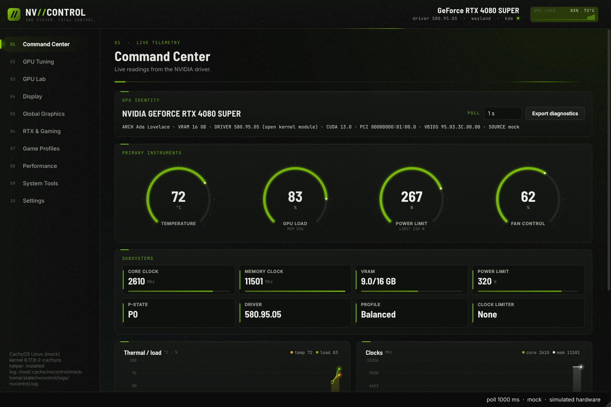

# NV//CONTROL

**ONE SYSTEM. TOTAL CONTROL.**

An NVIDIA control center for **CachyOS / Arch Linux** (KDE Plasma on Wayland first, X11 second).
It covers as much of NVIDIA App and NVIDIA Control Panel as Linux actually allows. Where Linux
can't do something, the app says so plainly instead of showing a fake switch.



## What it does

| Section | What you get |
|---|---|
| **01 Command Center** | Live gauges and graphs: temperature, load, power, fan, core/memory clocks, VRAM, P-state, clock limiters. Selectable polling (250 ms – 5 s). Diagnostic report export |
| **02 GPU Tuning** | Power limit, core/memory clock offsets, clock locking (undervolt recipe), manual fan speed. Presets: Balanced / Max Performance / Quiet / Power Efficient / Custom. **TEST 20 s** auto-reverts. Startup profile with crash guard. Reset to defaults. Fan curves via LACT |
| **03 GPU Lab** | Everything NVML lets you touch on this card: **temperature target** (GPU backs off boost at N °C), **memory clock locking**, **per-fan speed**, a real **fan-curve service** (draggable curve editor, 87 °C failsafe, hysteresis, keeps running with the app closed), **persistence mode**, **Prefer maximum performance**, and a live **SENSORS** table (thermal limits, per-fan speed/target/RPM, PCIe link and throughput, BAR1/Resizable BAR, NVENC/NVDEC, energy, time spent power/thermal-limited, P-state clock ranges) |
| **04 Display** | Resolution, refresh, scale, position, VRR (G-SYNC Compatible), HDR, ICC, compositor brightness (KDE) or xrandr (X11). Per-monitor Digital Vibrance with IDENTIFY (nvidia-settings on X11, nVibrant on Wayland). Real monitor brightness/contrast over DDC/CI. Risky changes auto-revert after 15 s |
| **05 Global Graphics** | The NVIDIA App's *Graphics ▸ Global settings* list row by row. Linux-supported rows become a session environment file plus a DXVK config, so they apply to **every game**: DLSS preset overrides (SR/RR), DLSS SR mode (DLAA / custom render scale), FG override, MFG count (RTX 50), NGX updater, DLSS indicator, Smooth Motion, low latency mode, V-Sync, max frame rate, triple buffering, anisotropic filtering, negative LOD bias, threaded optimization, shader cache size. Power management mode and monitor technology (VRR) apply immediately. Windows-only rows are listed with alternatives |
| **06 RTX / Gaming** | Per-feature status for DLSS SR/RR/FG/MFG, Smooth Motion, Reflex: who controls it (game, Proton or driver) and how to use it. Defaults for new profiles. Proton / GE-Proton discovery |
| **07 Game Profiles** | Steam library (only after you allow it). Per game: Proton version, Smooth Motion (only when supported), DLSS preset overrides, DLSS SR mode (DLAA / custom scale), NGX updater, DLSS indicator, NVAPI, shader cache, MangoHud, FPS limit, GameMode, Gamescope, extra env, game args, notes. **Live preview of the exact launch string.** Writing to Steam is safe: Steam must be closed, a backup is taken, other settings are kept, the write is atomic and verified, and you can roll back. Profiles import/export |
| **08 Performance** | Global MangoHud config (preset, FPS cap, position, toggle key, logging), GOverlay, and what's global vs per-game vs launcher-only |
| **09 System Tools** | Launch/install LACT, NVIDIA Settings, MangoHud, GOverlay, Steam, Gamescope, KDE display settings, ProtonUp-Qt. One-click diagnostics (nvidia-smi, vulkaninfo, kernel log, services). Full feature matrix |
| **10 Settings** | Polling, animations, scanlines, sound, **logs & bug report**, setup wizard, and a certain button |

A **first-run wizard** inspects the system, offers to install missing dependencies (showing the exact `pacman`
command first), shows the feature matrix, applies a preset (snapshotting your original values), and
opens the dashboard.

The full research behind every feature status is in **[docs/CAPABILITY_AUDIT.md](docs/CAPABILITY_AUDIT.md)**.

## Install (CachyOS / Arch)

```bash
tar xf nvcontrol-0.1.0.tar.gz && cd nvcontrol
./install.sh
```

`install.sh` builds a native pacman package with `makepkg` (from the included `PKGBUILD`), installs it with its
dependencies (`pyside6`, `python-nvidia-ml-py`, `polkit`, all from official repos), enables the startup-tuning
units, and can optionally install LACT / MangoHud / GOverlay / Gamescope. No Flatpak, no pip, no AUR required.

Then start **NV//CONTROL** from the application menu or run `nvcontrol`.

Try it without touching hardware: `nvcontrol --mock` (simulated RTX 4080 SUPER and a fake Steam library,
using a separate config folder).

### Updating

Updating no longer needs `git pull`. Any of these works:
* In the app: **SETTINGS ▸ Updates ▸ UPDATE NOW**. NV//CONTROL checks GitHub at startup and shows **⬆ UPDATE AVAILABLE** in the status bar when there's a new version.
* App menu: right-click NV//CONTROL ▸ **Update NV//CONTROL**
* Terminal: `nvcontrol --update` (or `bash ~/nvcontrol/update.sh`)

The updater opens a terminal (it needs your sudo password to reinstall), lists the new changes, pulls them,
rebuilds the package and tells you to restart the app. Log: `~/.local/state/nvcontrol/logs/update.log`.

### Command line
```
nvcontrol                 normal start
nvcontrol --mock          demo mode (simulated GPU + Steam)
nvcontrol --verbose       debug logging, also to the terminal
nvcontrol --wizard        re-run the setup wizard
nvcontrol --update        update from GitHub and reinstall
nvcontrol --diagnostics   print the system/feature report
nvcontrol --bug-report    report + recent logs (paste this when asking for help)
```

## Logs & feedback

* App log: `~/.local/state/nvcontrol/logs/nvcontrol.log` (rotating). It records every external command, every failure with its stderr, every privileged action, Steam writes with backup paths, Qt warnings and full tracebacks of unexpected errors.
* Root helper audit log: `/var/log/nvcontrol-helper.log`
* In the app: **SETTINGS ▸ COPY BUG REPORT** puts diagnostics plus the latest log lines on your clipboard.

## Architecture

```
nvcontrol/
  core/          runner (safe subprocess: arg lists, timeouts, no shell), config (XDG, atomic writes,
                 backups), logs, report
  backend/       NVML / nvidia-smi / mock GPU backends (read-only)
  capabilities/  system inspection + feature matrix (status per feature)
  integrations/  steam + VDF parser, mangohud, display (kscreen/xrandr/nvibrant/ddcutil), lact, tools registry
  profiles/      game profiles, launch-option builder, store (import/export)
  tuning/        presets, helper client (pkexec), mock helper
  helper/        nvcontrol-helper: the ONLY root component (fixed subcommands, driver-range validation, audit log)
  ui/            PySide6 interface, wizard, theme, Veneco Mode
```

Security model: the GUI never runs as root (it refuses to). Hardware writes go through
`pkexec /usr/lib/nvcontrol/nvcontrol-helper <fixed subcommand> <numbers>`, governed by the polkit action
`org.nvcontrol.helper` (`auth_admin_keep`). The helper runs Python in isolated mode, never uses a shell,
validates against driver-reported limits, and logs every call. Dependency installs show the exact
command before polkit asks for your password.

## Tests

```bash
QT_QPA_PLATFORM=offscreen python -m pytest -q
```
70+ tests run without NVIDIA hardware using mocked GPU, mocked Steam tree and mocked helper. They cover
VDF round-trips, Steam write safety (running-guard, backup, preservation, rollback), launch-option
quoting and injection resistance, Smooth Motion gating per GPU/driver, feature-matrix logic, helper
validation and crash guard, MangoHud config merging, logging and crash capture, and a UI smoke test
of every page plus Veneco Mode.

## Not implemented / limits (honest list)

* **VF-curve editing** (per-voltage points) isn't exposed by NVIDIA on Linux; LACT has the closest tooling. Fan curves are built in (GPU LAB), or use LACT's, but not both at once.
* **Per-game GPU tuning profiles** are not switched automatically. Tuning is global; the profile field is a reminder. LACT can auto-switch its own profiles by process.
* **Multi-GPU**: telemetry/tuning use the first NVIDIA GPU (`selected_gpu` in settings.json). There's no GPU picker UI yet.
* **Non-Steam launchers** (Lutris, Heroic): the launch-option preview can be copied, but they aren't written automatically.
* **Digital Vibrance on Wayland** depends on nVibrant (not in official repos). The value is applied to every GPU port automatically.
* **Gamma / contrast on Wayland**: no driver or KWin API. Use ICC profiles or DDC/CI.
* **Windows-only**: DSR/DLDSR, RTX HDR, RTX Video Super Resolution, ShadowPlay, Freestyle, driver-level NIS, Low Latency Mode, Ansel. Alternatives are shown in the matrix.
* **Hardware-tested?** It was developed and tested against mocks. Real-hardware paths use documented NVML and nvidia-smi calls, but expect to report the first rough edges via the bug report.

## Uninstall

```bash
./uninstall.sh            # resets GPU to defaults, removes package, keeps your profiles
./uninstall.sh --purge    # also removes settings, backups, logs, /etc/nvcontrol
```

---

*Not affiliated with NVIDIA. NVIDIA, GeForce, RTX, DLSS, G-SYNC and Reflex are trademarks of NVIDIA Corporation.*
*Pressing Ctrl+Alt+V is at your own risk (it's cosmetic, the GPU doesn't care).*
